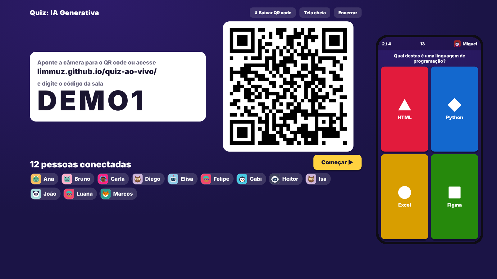
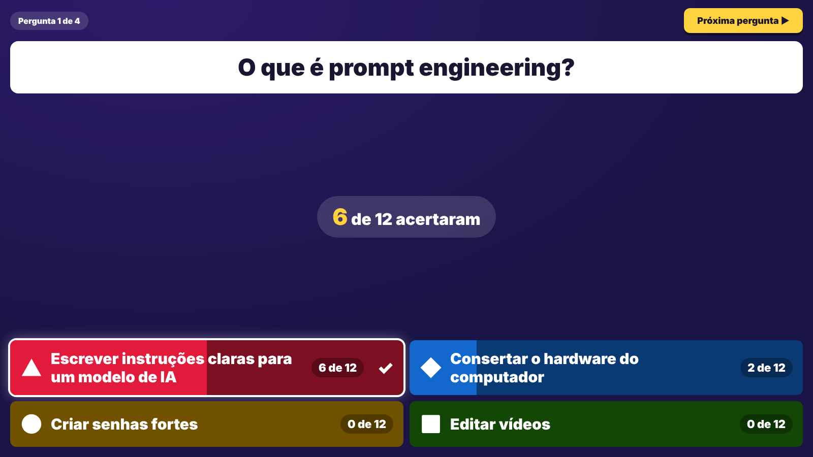
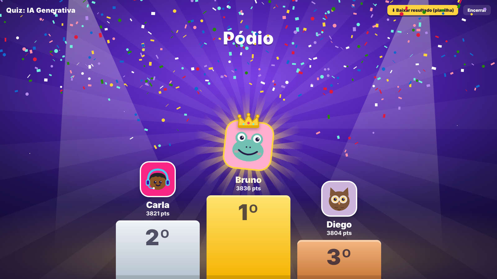
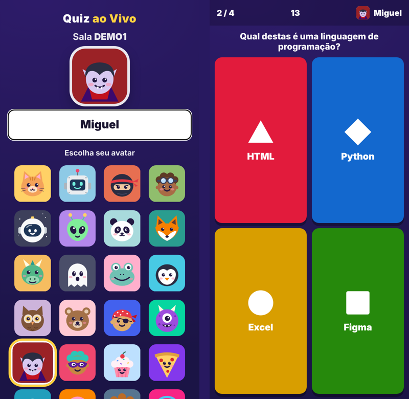

# Quiz ao Vivo 🎯

Plataforma de quiz em tempo real, no estilo Kahoot, para apresentações e aulas. O apresentador abre a sala no telão e os participantes entram pelo celular, lendo um QR code. Não precisa de servidor nem de instalação.

🔗 **Testar ao vivo:** https://limmuz.github.io/quiz-ao-vivo/
- **Apresentador:** abra `https://limmuz.github.io/quiz-ao-vivo/#apresentar` com a senha `demo` e o código **DEMO1**
- **Participante:** leia o QR code que aparece no telão ou digite o código da sala



## O problema
Eu precisava de um quiz interativo para uma apresentação da faculdade e para oficinas de HTML/CSS com alunos de 12 a 16 anos, sem depender de ferramentas pagas ou com limite de participantes.

## O que ele faz
- **Sala ao vivo** com entrada por QR code ou código, pensada para **100+ participantes**
- **Avatares e nome**: cada participante escolhe o seu no celular
- **4 alternativas por pergunta**, com cronômetro e contagem de respostas em tempo real
- **Pontuação por velocidade** (até 1000 pontos por acerto; no empate, ganha quem respondeu mais rápido)
- **Pódio animado**, revelado do 3º ao 1º lugar
- **Planilha de resultado (.xlsx)** gerada no próprio navegador, sem biblioteca externa
- **Editor de quiz** com exportação em JSON
- **Quizzes protegidos**: os arquivos da pasta `quizzes/` ficam criptografados (AES-GCM) com a senha do apresentador, então quem abre o arquivo não vê as respostas
- **Reconexão automática** se o celular perder a conexão

| Resultado da pergunta | Pódio | Celular |
|---|---|---|
|  |  |  |

## Como funciona
A comunicação entre o telão e os celulares é **peer-to-peer (WebRTC)** via [PeerJS]. O site é 100% estático (HTML, CSS e JS), então pode ser hospedado de graça no GitHub Pages ou no Netlify.

```
index.html
css/style.css
js/app.js        → lógica do apresentador e do participante
js/avatars.js    → avatares em SVG
js/planilha.js   → gera o .xlsx de resultado
js/lib/          → PeerJS, QR code e leitor de QR (jsQR)
quizzes/         → quizzes publicados (DEMO1.json é um exemplo aberto)
```

## Como usei IA
Construí o projeto com **vibe coding**: descrevi em linguagem natural o fluxo do apresentador, o fluxo do participante e as regras de pontuação, deixei o agente de IA gerar o código em etapas e revisei e testei cada parte antes de seguir. Mantive HTML, CSS e JS em arquivos separados para facilitar a manutenção.

## Para que foi criado
- Apresentação de matéria na faculdade (Senac, Análise e Desenvolvimento de Sistemas)
- Oficinas de HTML/CSS do projeto de extensão na escola IU Education (novembro de 2026), com quiz no início e no fim da aula

## Rodar localmente
```bash
git clone https://github.com/limmuz/quiz-ao-vivo
cd quiz-ao-vivo
python -m http.server 8000
# abra http://localhost:8000/#apresentar
```
> Para usar com celulares de verdade, publique o site (GitHub Pages/Netlify): o QR code aponta para o endereço publicado.

## Trocar a senha do apresentador
Abra o site com `#gerar-senha` no final do endereço, digite a nova senha e cole o código gerado em `SENHA_HASH`, no começo de `js/app.js`.

[PeerJS]: https://peerjs.com/
